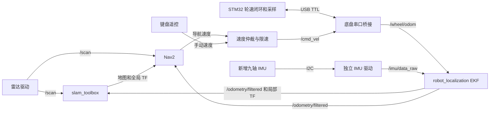

# 树莓派 5＋STM32 差速小车实施计划

实施更新（2026-10-25）：已在 `../robot_console` 编写 Windows 桌面上位机、SSH 网关、RViz/VNC 入口和数据接口，并修改 `../10.8` 的底盘协议及默认禁能/超时逻辑。详见 `../robot_console/README.md`。按用户要求仅本地开发和打包，未进行程序运行测试、远程部署、固件编译/烧录或硬件验证。下文的“尚未开发”描述为原规划时状态，以该 README 的当前实现与限制为准。

日期：2026-10-25。本文为规划，不包含固件修改、烧录或电机动作。

## 已确认的范围

- 四个普通轮，左右差速；右侧为 A/B，左侧为 C/D，最终仍需逐轮实测符号。
- 树莓派与 STM32 使用 USB 转 TTL 串口连接。
- 雷达为 DELTA2C Pro-D-V001，连接 Pi GPIO15，设备为 `/dev/ttyAMA0`。
- 目标是可调试的 ROS 2 小车，先手动遥控、融合里程计与建图，再接入地图定位和目标点导航。
- 新增一块九轴 IMU，通过树莓派 I2C 独立采集，作为 ROS 融合的主 IMU；型号尚未确定。
- 保留四路电机编码器；STM32 原有 ICM20948 暂保留作底盘本地测试或对照，不默认作为第二路融合输入。
- 保留 Debian 13 宿主机＋Ubuntu 22.04 / ROS 2 Humble 容器，不在第一阶段迁移 ROS 发行版。

## 代码检查结果

| 项目 | 当前实现 | 对接前处理 |
| --- | --- | --- |
| MCU | STM32F103RCT6，Keil 工程 `10.8/MDK-ARM/WHEELTEC.uvprojx` | 在现有工程内增量改造 |
| 速度环 | TIM6 100 Hz，四路编码器＋增量 PI | 保留闭环，测量控制周期与中断耗时 |
| 启动速度 | `Core/Src/main.c:153` 设置 `Move_X=0.30f` | 改为上电禁能、零目标，收到有效使能后才接管 |
| 等速测试 | `BALANCE/CONCTRL/conctrl.c:11` 中 `WHEEL_SPEED_ONLY_TEST=1` | 测试与 ROS 速度模式分开，生产模式不能忽略角速度 |
| ROS 控制 | 有 11 字节速度帧和相对角度命令 | 导航只使用连续 `vx/wz`，相对转角单独保留为测试功能 |
| 串口 | USART1：PA9/PA10，115200；USART3：PC10/PC11，9600 | 优先 USART1 作为二进制底盘协议口 |
| 上报 | 主循环输出 VOFA 文本；存在 24 字节旧上报打包和发送函数，当前正常循环未调用它们 | 同一 UART 不混发文本；新增稳定的传感器反馈链路 |
| 运动学 | 当前左右差速分轮，但旧上报仍含横向速度表达式 | 统一为四轮差速运动学 |
| 角速度 | 旧反馈公式与当前分轮公式的符号、比例不一致 | 重新标定并用物理左转验证正号，不能直接沿用旧 Z_speed |
| IMU | ICM20948，已有原始陀螺仪、加速度和姿态处理 | 核对量程、单位、零偏、安装方向及传感器有效状态 |
| 慢速转动 | 姿态处理将绝对值小于 0.05 rad/s 的 Z 角速度清零 | ROS 融合应使用原始或仅去零偏的数据，避免丢失缓慢旋转 |

当前代码配置：轮径 0.048 m、轮距 0.130 m、轴距 0.115 m、编码器 1040 计数/轮转。这些仅是软件参数，不能当成已经完成的实物标定。

树莓派此前已跑通雷达与纯雷达 Cartographer 局部地图；这不等同于底盘闭环、精确地图或自动导航已完成。本次读取时 `ros2-humble` 开发容器处于停止状态，后续需完善可重复启动流程。

## 第一版架构

STM32 负责编码器采样、轮速闭环、速度限幅和失联停车；树莓派通过独立 I2C 驱动采集新增 IMU，并负责 ROS 消息、轮式里程计、融合、SLAM 和 Nav2。第一版不在 STM32 上引入 micro-ROS，也不先接入 ros2_control；用独立串口桥接节点降低联调复杂度。



主路线建议为 `robot_localization EKF + slam_toolbox + Nav2`。IMU 通过 EKF 参与连续局部运动估计，slam_toolbox 使用雷达和融合后的 TF；不是要求 slam_toolbox 直接订阅 IMU。

现有 Cartographer 保留为独立的纯雷达对照模式，第一版不再同时融合两套 SLAM。正式模式下必须关闭原来发布 `map → odom → laser` 的测试实例。

## 阶段一：整理底盘并完成串口闭环

### STM32 工作

1. 上电目标为零，上位机未连接或未使能时不允许自行运行。ROS 轮速模式不应因旧 ICM20948 初始化失败而永远卡在启动循环；依赖旧 IMU 的本地航向测试则仍需单独校验其就绪状态。
2. 增加明确的禁能、ROS 速度控制和台架测试模式；不能仅关闭等速测试宏后继续套用自动直行纠偏逻辑。ROS 模式应正确接受前进、后退、原地转向和小角速度弯道。
3. 保留 100 Hz 电机速度闭环。串口接收中断只入缓冲，协议解析和反馈打包放入专门模块；发送优先使用 DMA，避免逐字节阻塞影响控制。
4. 每 10 ms 累计四轮编码器，反馈累计计数而不是只反馈某一周期的增量；串口偶尔丢包仍可恢复总位移。
5. 增加有效速度命令超时。建议初值 300 ms；超时进入零目标/停车流程，清理相应控制状态，机械停车距离需实测。
6. 无效 CRC、过期序号、错误帧和普通心跳不能替代有效速度命令来续命。上位机重启后不能沿用旧的非零速度。
7. 提供 MCU 复位标识、错误位、电压和控制周期统计；保留旧 IMU 时可上报其本地测试状态。

`main.c` 只保留初始化与周期任务调用。协议、控制模式、反馈和测试逻辑放到对应模块；新增及修改代码使用 UTF-8 简体中文说明与 Doxygen 风格函数注释。

### 串口协议

沿用现有串口硬件，统一定义一个有版本的二进制协议，双方按同一文档实现，不同时维护多套自动识别的控制协议。建议帧字段：

`帧头 | 版本 | 消息类型 | 长度 | 序号 | MCU 采样时间 | 数据区 | CRC16`

需要明确端序、缩放、CRC 参数和覆盖范围、最大长度、失步恢复、复位和时间戳回绕处理。旧 11/24 字节协议可作为参考，但不直接当作最终协议。

| 方向 | 内容 | 建议初始频率 |
| --- | --- | --- |
| Pi → STM32 | `vx`、`wz`、使能状态 | 20–50 Hz |
| STM32 → Pi | 四路累计编码器、采样时刻、反馈状态 | 50 Hz |
| STM32 → Pi | 旧 IMU 对照数据，仅在调试模式启用 | 可选，不作为主 IMU 链路 |
| STM32 → Pi | 电压、错误位、固件版本、周期统计 | 1–5 Hz |

先用 115200、8N1，按最终帧长核算负载，保留余量后再决定是否提高波特率。传感器时间以采样时刻为准；桥接节点处理 MCU 时间到 ROS 时间的映射，不能把所有数据都简单标成串口读到的时间。

### 物理连接

| USB 转 TTL | STM32 USART1 |
| --- | --- |
| TXD | PA10 / RX |
| RXD | PA9 / TX |
| GND | GND |

适配器插到树莓派 USB，使用 3.3 V 逻辑电平；不能仅凭 VCC 跳帽判断 TX 电平。两端独立供电时通常不接适配器 VCC，以免回灌。具体连接还需核对底盘接口实物标识。

雷达继续占用 GPIO14/15，不与 STM32 并联。底盘设备优先采用 USB 唯一序列号或 `/dev/serial/by-id/` 定位，之后可建立 `/dev/stm32_chassis`，不依赖变化的 `/dev/ttyUSB0` 编号。

验收：USB 插拔和 MCU 复位能恢复；解析器能处理拆包、粘包和坏包；四轮正反转反馈一致；旧命令不会在重连后复活；失联能进入停车流程。

## 阶段二：ROS 桥接、标定与键盘遥控

新增 `chassis_bridge` 包：串口收发、协议、轮式里程计分模块实现，不把全部逻辑塞入节点主函数。

| 接口 | 类型或内容 |
| --- | --- |
| 订阅 `/cmd_vel` | Humble 使用 `geometry_msgs/Twist`，仅取 `linear.x` 和 `angular.z` |
| 发布 `/wheel/odom` | `nav_msgs/Odometry`，纯编码器结果，不发布 odom TF |
| 可选发布 `/chassis/imu_raw` | 原板载 IMU 对照数据，与新增主 IMU 分开命名 |
| 发布 `/joint_states` | 四轮位置与速度，用于查看左右和各轮一致性 |
| 发布 `/battery_state` | 电压及已知状态，不伪造未标定的电量百分比 |
| 发布 `/diagnostics` | 通信、采样、校准、故障、命令时效、丢包和 MCU 复位 |

差速模型统一为：

```text
vR = (vA + vB) / 2
vL = (vC + vD) / 2
vx = (vR + vL) / 2
wz = (vR - vL) / b_eff
```

其中 `b_eff` 是经转弯实测得到的有效轮距。四轮滑移转向不能仅把机械轮距代入并假定准确，也不能未经验证继续使用“轴距＋轮距”。

按“逐轮计数 → 直行距离 → 左右转角 → 多次往返”标定轮径、编码器比例、正负号和有效轮距。初始可把直行 1 m 误差不超过 5%、转一圈误差不超过 5°作为待实测调试目标，不是现有系统已达到的指标。

新增 IMU 驱动负责 `/imu/data_raw`，坐标为 `imu_link`，通过真实安装变换转到车身坐标；避免先手动交换轴又在 TF 中重复旋转。验证静止角速度、重力模长及左转时 Z 角速度为正。未提供可信姿态时，设置 IMU 姿态协方差首项为 -1，不假造姿态有效。第一版不依赖电机附近的磁力计绝对航向，也不靠加速度两次积分估计平移。

### 新增 I2C 九轴 IMU

型号待选，暂不固定设备地址、寄存器、供电电压或姿态算法。先预留独立 `imu_driver` 节点；型号确定后优先采用已有可维护驱动，再决定是否自行实现寄存器访问。

| IMU 信号 | Pi 5 标准 40 针排针 |
| --- | --- |
| SDA | GPIO2，物理 3 脚 |
| SCL | GPIO3，物理 5 脚 |
| GND | 例如物理 6 脚 |
| VCC / VIN | 必须按具体模块的供电要求决定，支持 3.3 V 供电的模块可接物理 1 或 17 脚 |
| DRDY / INT | 若模块提供，可另接空闲 GPIO，具体引脚在选型后分配 |

SDA/SCL 必须采用 3.3 V 逻辑和上拉；Pi 的 GPIO2/3 已有上拉，模块自带上拉时应核对并联后的总阻值。支持 5 V 供电不等于其 I2C 电平适合 Pi，不按接口线色猜测连接。

I2C 与现有 GPIO14/15 雷达串口、USB 底盘串口互不占用。启用后验证实际 `/dev/i2c-*` 节点与权限，将所需设备映射进 Humble 容器。IMU 短线布置并固定安装，优先读取 FIFO、数据就绪信号或芯片时间戳；没有硬件时间戳时测量采样抖动与读取延迟。

建议从 100 Hz 有效 IMU 消息开始，先验证稳定性，再按型号能力和实测需要提高频率。频率和协方差不能只按宣传值填写。

| 话题 | 内容 |
| --- | --- |
| `/imu/data_raw` | 三轴角速度与三轴加速度，`sensor_msgs/Imu` |
| `/imu/mag` | 三轴磁场，`sensor_msgs/MagneticField`，单位 T |
| `/imu/data` | 可选，经验证可信的融合姿态；不得标记未校准的姿态为有效 |
| `/diagnostics` | I2C 错误、采样率、时间戳、饱和与校准状态 |

主 EKF 初期使用新增 IMU 的 Z 角速度。九轴只是加入三轴磁场信息，航向效果还取决于陀螺零偏、磁校准和装车环境；磁力计需在电机停转与运转、不同电流下分别检查，再决定是否融合绝对 yaw。未验证前，旧 IMU 和新 IMU 不作为两路独立航向同时融合。

IMU 选型优先项：可查的陀螺零偏与噪声指标、稳定的 Linux/Pi 5 I2C 驱动、原始数据访问能力、FIFO/时间戳/DRDY、模块逻辑电平，以及实际装车标定和固定条件。仅有“九轴”或静态姿态精度宣传不足以确认导航效果。

先用键盘遥控，初始速度建议 0.1–0.2 m/s。命令仲裁保留手动优先级，桥接节点自身检查命令新鲜度，STM32 保留独立失联超时。

## 阶段三：融合里程计与完整 TF

新增 `robot_description`，描述真实外形、四轮、雷达和 IMU 的固定安装位置。雷达和 IMU 偏移需实测。

```text
map
 └─ odom
     └─ base_link
         ├─ laser
         └─ imu_link
```

| 变换 | 唯一发布者 |
| --- | --- |
| `map → odom` | 建图时 slam_toolbox；已存地图定位时 AMCL，二者不同时接管 |
| `odom → base_link` | robot_localization 的 EKF |
| `base_link → laser/imu_link` | robot_state_publisher 的固定关节 |

EKF 启用二维模式。先融合编码器前向速度、合适协方差的角速度以及 IMU Z 角速度；是否采用横向零速度约束按实际侧滑确定。协方差根据静止与运动记录估计，不能全部写零。避免把同一编码器积分出的位姿和速度当作独立信息重复融合。

建议发布 `/odometry/filtered` 与 TF 频率为 30–50 Hz。验收标准是静止不明显乱漂、左转方向正确、TF 连通且只有一个发布者、无持续时间戳错误；不是只看节点是否存在。

## 阶段四：遥控建图，再做已存地图导航

1. **遥控建图**：启用雷达、底盘、EKF、URDF 与 slam_toolbox。先慢速走一小圈，检查墙体是否重影、尺寸比例和左右方向是否正确，再扩大范围、保存和重载地图。
2. **固定地图定位**：停用建图节点，启动 map_server 与 AMCL，验证重新启动后能在地图上定位。
3. **Nav2 导航**：接入融合里程计、真实 footprint、雷达障碍层、膨胀层和差速运动约束。先验证短距离单点，再验证绕障和多点。速度/加速度上限与底盘限幅统一，目标取消或命令失联应进入停车流程。
4. `/scan` 使用匹配的 SensorData QoS。现有雷达没有逐点硬件时间戳，第一版低速测试，不能把此前局部地图演示当作高速运动去畸变或导航精度验证。

首个完整里程碑：键盘可控 → 轮速/IMU反馈正常 → EKF 连续里程计 → 遥控保存地图 → 重启定位 → RViz 中点击目标到达。

## 调试与部署

- 保留 `delta2c_lidar`；新增 `chassis_bridge`、独立 `imu_driver`（优先复用选定型号已有包）、`robot_description`、`robot_bringup`。初期在 bringup 中放 EKF、SLAM、Nav2 参数，无需再拆很多小包。
- 提供传感器、底盘遥控、建图、导航四种启动模式；测试模式与导航模式互斥，启动时清晰打印串口、固件版本、参数和错误。
- RViz 查看地图、TF、轮子与激光；rqt_plot 查看目标/实测轮速、IMU 与轮式角速度；使用 rosbag2 记录 `/scan`、IMU、原始/融合里程计、TF、速度和诊断，支持离线复现。
- 同一控制 UART 不混发 VOFA 文本。若继续使用 VOFA，安排独立调试口或专门测试模式；普通 ROS 调试优先消费标准话题。
- 固定 Docker 镜像与启动配置，确认串口设备映射、dialout 权限、热插拔、重连和日志限量。先通过手动验收，再决定开机启动。
- 已有树莓派欠压记录需要排查。电机供电与 Pi 的稳压支路做好分配，避免电机启动造成 Pi 重启；未完成供电稳定性验证前不宣称长期运行可靠。

## 图形化上位机计划

建议采用 Windows PySide6 桌面客户端＋树莓派 ROS 2 网关/进程管理服务。程序与 ROS 2 仍在树莓派的 Humble 容器中运行，Windows 不需要安装 ROS 2。本节描述待实现方案，不表示图形客户端、网关或服务已部署。

### 操作界面

- 连接区：树莓派 IP、用户名、SSH 端口、连接/断开、连接状态。
- 程序区：启动/停止雷达、底盘、IMU、遥控模式、建图模式和导航模式；未实现的组件明确禁用。
- 地图区：显示真实地图、激光、车体位姿和轨迹；以后支持点击目标，通过 Pi 侧 Nav2 action 客户端发送导航任务。
- 遥控区：按住方向键或按钮才持续发送速度，松开、窗口失焦和连接失效时撤销手动速度；STM32 保留独立命令超时。
- 调试区：目标/反馈轮速曲线、IMU 状态、电压、消息频率、通信故障、程序日志、地图保存与下载。
- 区分“进程运行”和“数据就绪”：雷达应实际收到新 `/scan`，建图应实际收到有效 `/map`，导航还需确认定位与控制链路。

### 通信和进程管理

1. Windows 建立 SSH 连接，并把 Pi 上仅监听回环地址的网关端口转发到本机。
2. SSH 用于连接、启动基础服务和维护；ROS 2 数据与按钮操作通过隧道内的 WebSocket 网关传输。
3. 网关使用 rclpy 订阅地图、扫描、里程计、IMU 和诊断，按需要限频传输。地图只在变化时更新，IMU 曲线可降采样显示，不改变传感器采样率。
4. 进程管理器只接受已登记的程序与参数，不把界面输入直接拼成任意 shell 命令。依赖、状态、退出码和日志集中管理。
5. ROS launch 由容器内管理器按独立进程组启动和停止，优先发送 SIGINT 并等待清理。不能假定杀掉 SSH 客户端或 docker exec 客户端就一定停止容器内程序。
6. 由 systemd 管理常驻网关及其应用容器生命周期，确保正常关闭容器时能通知管理器清理子进程。关闭电脑窗口与停止 ROS 程序是两个明确操作。
7. 第一版断连后的运动策略为停车，重连后人工重新使能；地图与日志任务是否继续运行由模式决定。软件停止按钮不替代底盘独立超时或物理急停。

SSH 隧道示意（网关服务安装后才有对应服务可访问）：

```powershell
ssh -N -o ExitOnForwardFailure=yes -L 127.0.0.1:18765:127.0.0.1:8765 xu@192.168.10.193
```

之后客户端访问本机 `127.0.0.1:18765`，流量经 SSH 转发给 Pi 网关。若电脑与树莓派不在同一可达网络，还需先解决 VPN、跳板机或其他网络可达性；端口转发本身不自动穿透任意 NAT。

### 如何启动预先写好的程序

每个程序登记：名称、执行环境、工作目录、ROS setup、命令和参数、依赖、就绪条件、停止方式、日志位置。Python 脚本、ROS executable 和 ROS launch 均可登记。程序应在指定环境中预先安装或 colcon build，通过预设启动项执行。

| 界面动作 | 树莓派实际工作 | 当前状态 |
| --- | --- | --- |
| 启动雷达 | 在 Humble 环境运行 `ros2 run delta2c_lidar lidar_node` | 已有程序 |
| 启动建图测试 | 运行现有 `mapping.launch.py`；客户端绘图时可设 `rviz:=false` | 已有纯雷达测试程序 |
| 保存地图 | 调用现有 `save_map.py`，检查输出后通过 SFTP 下载 | 已有脚本 |
| 启动底盘 | 运行待实现的串口桥接与反馈节点 | 尚未实现 |
| 启动 I2C IMU | 运行选定型号的 IMU 驱动 | 型号及驱动待确定 |
| 启动导航 | 检查传感器、里程计、定位就绪，再启动 Nav2 | 尚未实现 |

界面启动已在运行的程序时应返回其状态，不能重复占用串口。建图和固定地图导航模式切换时，按依赖顺序停止旧模式，避免重复 TF 发布。

现有程序目前仍可手动运行：第一个 SSH 终端先执行 `ros2-shell`，进入容器后运行雷达节点；另一个 SSH 终端在宿主机运行 `ros2-map`，通过 VNC 看 RViz。相关图形客户端按钮和后台服务尚需开发。

上位机第一版验收：连接 Pi → 一键启动雷达 → 看到实时扫描与诊断 → 启动已有建图测试 → 看到地图 → 停止指定程序 → 下载地图。底盘遥控按钮等串口闭环与停车逻辑通过后再启用。

## 下一步工作顺序

| 顺序 | 产出 | 通过条件 |
| --- | --- | --- |
| 1 | 底盘参数表和串口协议文档 | 轮序、引脚、单位、帧格式、时效规则明确 |
| 2 | STM32 ROS 速度模式与可靠反馈 | 上电不动、命令有效、转向正确、断链停车 |
| 3 | ROS 串口桥接、I2C IMU 驱动与遥控 | 两条链路可独立调试，能看到轮速、IMU、电压和诊断 |
| 4 | 里程计标定与 URDF | 距离/方向合理、安装参数实测 |
| 5 | EKF | 连续局部定位与唯一 TF 正常 |
| 6 | 遥控 SLAM | 小范围闭环、地图保存和重载通过 |
| 7 | AMCL＋Nav2 | 短距离目标、绕障、取消和失联行为通过 |

开始编写新增 IMU 驱动前需确定具体型号和模块资料；底盘工作还需核对 USB 转 TTL 模块、真实轮径/轮距/车体外形、雷达与新增 IMU 的安装方向和偏移。IMU 尚未选定不阻碍先完成 STM32 串口、编码器和遥控部分。

## 参考

- [Nav2 状态估计与 TF 职责](https://docs.nav2.org/rolling/getting_started/navigation_concepts/state_estimation/)。
- [robot_localization Humble 配置说明](https://github.com/cra-ros-pkg/robot_localization/blob/humble-devel/doc/configuring_robot_localization.rst)。
- [robot_localization Humble 传感器坐标与数据准备](https://github.com/cra-ros-pkg/robot_localization/blob/humble-devel/doc/preparing_sensor_data.rst)。
- [slam_toolbox](https://github.com/SteveMacenski/slam_toolbox/tree/humble)。
- [Pi 5 排针、电平与 I2C 接口](https://www.raspberrypi.com/documentation/computers/raspberry-pi.html)。
- [OpenSSH 远程命令与本地端口转发](https://man.openbsd.org/ssh)。
- [systemd 服务管理](https://www.freedesktop.org/software/systemd/man/latest/systemd.service.html)。

以上文档用于架构和接口参考；具体可执行文件、消息和参数以实际安装的 Humble 版本为准。
