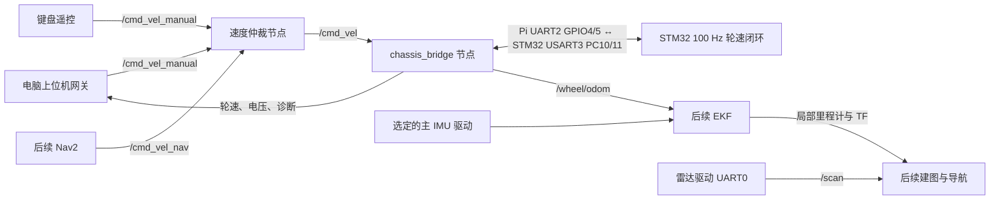

# 树莓派 5 GPIO UART2 与 STM32 USART3 的 ROS 2 通信实施方案

> 实施更正（2026-10-27）：用户确认 GPIO4/5 已接雷达，底盘改用 GPIO8/9 的 UART3，设备 /dev/ttyAMA3；STM32 仍为 USART3 PC10/PC11。UART3 已在线启用并保存开机配置。下文 UART2 接线为此前规划，当前接线与烧录以 [UART3 接线与烧录](../robot_console/UART3_接线与烧录.md) 为准。

日期：2026-10-27。用户已选择树莓派另一组 GPIO 串口直连底盘 PC10/PC11。
本文为源码审阅和 SSH 只读检查后的规划；未修改固件、启动配置，未烧录或发送运动命令。不能据此确认当前板上固件与本地源码一致。

## 1. 现场及源码核对结果

| 对象 | 已确认情况 | 实施含义 |
| --- | --- | --- |
| MCU | STM32F103RC，现有 HAL/Keil 工程 | 保留当前驱动、四轮编码器和速度 PI |
| PC10/PC11 | USART3 部分重映射；PC10=TX，PC11=RX；当前 9600/8N1 | 改为 115200/8N1，保留重映射 |
| USART3 收发 | 接收回调仍解析旧蓝牙 APP；fputc 输出到 USART3；main 仍调用 APP_Show，内部 printf | 必须移除通信口的蓝牙解析和文本输出，并保留独立电压采样 |
| 新通信模块 | chassis_link.c 已实现 AA55、CRC、会话、禁能及 300 ms 超时，但硬编码 huart1 | 复用并迁移到 huart3，不能只改串口初始化 |
| 运动控制 | TIM6 100 Hz；右侧 A/B、左侧 C/D；ROS 控制路径已直接分配 vx/wz | 保留当前控制周期，实测各轮符号和转向 |
| 编码器 | 每周期读取并清零硬件计数器，只有轮速快照上报 | 在现有读取点累计原始脉冲，不能增加第二次读取 |
| IMU | main 无限等待板载 ICM20948 初始化；控制使能依赖 Heading_Gyro_Ready | 改为有界初始化并报告故障，明确纯轮速模式是否必须依赖 IMU |
| 使能初始化 | Motor_Init 仍写 STBY=1，main 随后写回 0 | 统一为上电禁能，消除短暂拉高 |
| 本机上位机 | robot_console 网关直接写串口，不发布 /cmd_vel | 改为经 ROS 2 统一入口控制，串口只有一个所有者 |
| Pi 系统 | xu@192.168.10.193，Pi 5，Debian 13 ARM64 | 沿用 Ubuntu 22.04 / ROS 2 Humble 容器 |
| 容器现场 | ros2-servo 运行；ros2-humble 停止；ros2-jazzy 停止 | 不并行启动重复舵机实例；底盘与雷达环境统一到 Humble |
| ROS 现场 | 运行环境查询仅发现 /servo_pwm_controller 和 /servo/angle_cmd | 底盘桥尚未部署；雷达建图当前未运行 |
| Python 依赖 | ros2-servo 中未发现 pyserial；ros2-humble 内依赖本次未启动检查 | 在目标运行容器逐项检查并补齐，不能由同镜像名推断依赖相同 |
| GPIO 现场 | GPIO14/15 为 UART0，雷达配置 /dev/ttyAMA0；GPIO12 为舵机 PWM | 继续保留，底盘使用 UART2 |
| UART2 | GPIO4/5 当前 pinctrl 显示 none；本机 overlays/README 支持 uart2-pi5；pinctrl funcs 确认 GPIO4=TXD2、GPIO5=RXD2 | 实物未接其他外设后可用；目前尚未启用 |
| 串口别名 | /dev/serial0 指向 ttyAMA10，并被内核 console 使用 | 不用 serial0 代替底盘端口，也不套用旧型号默认串口接线 |
| 供电 | vcgencmd get_throttled 返回 0x50005 | 当前欠压、限频及相应历史标志；联调前检查稳压、电源线和负载 |

旧 ROS2_CAR_PLAN.md、robot_console/README.md 中优先 USART1、USB TTL 的接线规划，由本方案的 GPIO UART2 → USART3 方案替代。

## 2. 接线和 Linux 串口启用

| 树莓派 5（BCM 编号） | 40 针物理脚号 | STM32 底盘 |
| --- | --- | --- |
| GPIO4 / UART2 TXD | 7 | PC11 / USART3 RX |
| GPIO5 / UART2 RXD | 29 | PC10 / USART3 TX |
| GND | 例如 6 | GND |

采用 3.3 V TTL，TX/RX 交叉，共地；两板独立供电时通信线不接 5 V、3.3 V 电源脚。先确认底盘排针确实直接引出 PC10/PC11，若带蓝牙模块应断开该模块，不能两个 TX 并接。接线短且远离电机动力线。

实施时先备份 /boot/firmware/config.txt，在适用于该板的配置段新增 dtoverlay=uart2-pi5；保留 uart0-pi5 与舵机 PWM 配置。安排重启后，用 pinctrl、设备树与实际设备节点核对 UART2 映射。预期 /dev/ttyAMA2，但必须以重启后的实际映射为准，不先写死。

为确认的 UART2 建立明确的 /dev/stm32_chassis 设备名或在参数中固定核验后的设备路径。确认该口没有 console/getty 和其他进程占用。GPIO 串口不走 USB 的 by-id 规则；容器须能访问实际字符设备，应用以独占方式打开。保留现有 serial0 调试控制台配置。

## 3. 控制架构



STM32 继续负责实时闭环、编码器、限幅和失联停车；树莓派负责 ROS 消息、串口转换、里程计和上层算法。第一版使用普通二进制串口桥，不在 MCU 上移植 micro-ROS，也不先引入 ros2_control。

chassis_bridge 是 UART2 的唯一打开者。网关不再直接打开底盘串口；它发布 ROS 请求、调用使能服务并订阅反馈。手动与导航通过仲裁节点明确切换；第一版只启用手动输入，后续接 Nav2 时再增加导航来源。

## 4. STM32 改造范围

1. usart.c 和 WHEELTEC.ioc 同步 USART3=115200/8N1；USART3 Rx 回调只入 chassis_link 环形缓冲。确认 USART3 IRQ 同时处理 HAL 收发，补齐溢出、帧错误后的接收恢复。
2. chassis_link.c 中发送状态检查、非阻塞发送改为 huart3，接收入口迁到 USART3。USART1 取消运动协议入口，作为可选独立调试口。
3. USART3 停止 printf、APP_Show 文本和蓝牙解析。将 APP_Show 内 ADC/电池更新独立出来，避免删掉调用后电压数据停止更新；OLED 刷新限频，避免拖延协议解析。
4. Motor_Init 与 GPIO 上电状态统一禁能。保留 100 Hz 轮速 PI、禁能时清除积分和 PWM；纯轮速模式不套用旧直行纠偏、定角转动和蓝牙状态机。
5. 编码器在 Get_Velocity_Form_Encoder 既有读数后累加四轮原始脉冲。回绕采用明确定义的整数模运算，避免有符号溢出；反馈使用同一次控制采样的原子快照。
6. 上报 MCU 启动标识和采样 tick；桥接节点检测复位、回绕及连接变化，重建计数基准，不把复位计数差积分成大位移。
7. IMU 初始化设置超时并持续报告状态。建议纯编码器轮速控制与 IMU 就绪解耦；依赖姿态的本地测试仍要求 IMU 有效。不得仅删除检查而未处理后续 IMU 调用路径。
8. ISR 接收仅入队，协议解析与发送在独立模块。先沿用非阻塞中断发送并测量占用；若影响控制时序，再使用可用的 DMA 通道，不无条件更换整个驱动。

main 仅保留初始化与周期任务调用，协议、采样和测试放各自模块；新增或修改的功能使用 UTF-8 简体中文 Doxygen 注释，说明参数和返回值。

## 5. 串口消息规划

复用 robot_console/PROTOCOL.md 的 AA55 封装、小端、CRC16/CCITT-FALSE、长度上限、序号及会话。既有控制帧总长 23 字节，反馈帧总长 60 字节。115200/8N1 每方向理论约 11520 字节/秒；50 Hz 现有反馈约占发送方向 26%，9600 波特率则不足以承载。

| 消息 | 频率 | 内容 |
| --- | --- | --- |
| 速度命令 | 20–50 Hz | vx(mm/s)、wz(mrad/s)、使能、会话和序号 |
| 既有轮速/姿态反馈 0x81 | 50 Hz | 四轮实际和目标速度、板载 IMU、电压及状态 |
| 新累计编码器反馈（建议 0x82） | 50 Hz | 四轮 32 位累计计数、控制采样 tick、启动标识、故障状态 |
| 诊断/版本 | 1 Hz | 协议能力、固件标识、接收错误与控制周期统计 |

新消息编号、能力协商和字段在实现前统一写入协议文档；不能静默修改现有 0x81 长度和含义。新增四轮累计计数帧按最终帧长重算负载，第一版总发送占用目标低于 60%。若升级主协议版本，MCU、桥接和上位机解码须同步。

采样 tick 必须取自控制采样时刻，而非打包时间。Pi 用单调时钟处理超时，记录 MCU→ROS 时间映射与串口延迟，ROS 时间跳变时重建映射。

命令状态机：上电禁能 → 零速禁能帧同步会话 → 人工申请使能 → 零速使能得到反馈确认 → 接受新鲜非零命令。Pi 收到过期命令或反馈超时立即撤销使能；STM32 独立在 300 ms 无有效新命令时禁能。CRC 错、重复序号和普通心跳不能续命；重连与 MCU 复位后不自动恢复非零速度。

Pi 初值命令超时 200 ms、反馈超时 200 ms；不能由桥接定时器反复发送旧速度来刷新来源时效。ROS 速度订阅用 volatile、keep-last 1，避免积压命令；日志明确区分请求使能和 MCU 确认使能。

## 6. ROS 2 包及接口

先新增 ament_python 包 chassis_bridge，采用 rclpy + pyserial；协议、节点、里程计分文件。另以 robot_bringup 管理参数、仲裁和启动，不扩展过多包。

| 接口 | ROS 2 类型 | 约定 |
| --- | --- | --- |
| /cmd_vel | geometry_msgs/msg/Twist | 输入 linear.x(m/s)、angular.z(rad/s)，前进和左转为正 |
| /chassis/enable | std_srvs/srv/SetBool | 使能请求需验证通信、零速握手；返回明确失败原因；状态以 MCU 反馈为准 |
| /wheel/odom | nav_msgs/msg/Odometry | frame_id=odom，child_frame_id=base_link，位置和速度含合理协方差 |
| /joint_states | sensor_msgs/msg/JointState | A/B/C/D 四轮位置(rad)、角速度(rad/s)，不虚构 effort |
| /battery_state | sensor_msgs/msg/BatteryState | 发布已测电压，未知电量用未知值 |
| /chassis/imu_raw | sensor_msgs/msg/Imu | 可选板载 IMU；转为 rad/s、m/s²，无可信姿态时 orientation_covariance[0]=-1 |
| /diagnostics | diagnostic_msgs/msg/DiagnosticArray | 串口、CRC、命令新鲜度、MCU 复位、IMU及欠压等 |

四轮目标和实测曲线初期放诊断和上位机数据显示；若需要高频结构化记录，再定义语义明确的 ChassisState 消息，避免使用含义不明的数组承载控制协议。

节点参数：串口、115200、命令频率与超时、反馈超时、速度上限、各轮符号、每转计数、轮径、有效轮距、坐标系、是否发布里程计 TF。初期速度限值沿用 ±0.2 m/s、±0.7 rad/s。

## 7. 里程计、IMU 和 TF

软件当前初值：轮径 0.048 m、每转计数 1040、轮距 0.130 m，均需实测。

```text
ΔsR = (ΔsA + ΔsB) / 2
ΔsL = (ΔsC + ΔsD) / 2
Δs = (ΔsR + ΔsL) / 2
Δyaw = (ΔsR - ΔsL) / b_eff
```

用累计计数差和采样时间差计算速度及平面位姿，采用中点或圆弧积分。四轮滑移转向的 b_eff 应通过转圈标定，不能直接宣布机械轮距准确。逐轮检查 A/B/C/D 实物位置与符号，再标定距离和转角。

第一阶段只验证编码器控制与反馈。板载 ICM20948 可作对照；此前规划的独立 I2C 主 IMU 尚未选型，本方案不假设其已接入，也不把两份同源姿态重复融合。

仅轮式里程计阶段，可由桥接节点发布 odom→base_link。接入 robot_localization 后关闭桥接 TF，改由 EKF 唯一发布；固定安装变换由机器人描述发布。完整链为 map→odom→base_link→laser/imu_link。建图或 AMCL 分阶段负责 map→odom。

现有 Cartographer 配置 use_odometry=false、tracking_frame=laser、published_frame=laser，不能直接与新底盘 TF 混用。先保留为独立对照模式；正式接入里程计后单独配置建图模式，避免同一 TF 出现两个发布者。

## 8. 实施顺序和验收

| 阶段 | 工作 | 完成条件 |
| --- | --- | --- |
| 1：接口与供电 | 确认 PC10/11 排针和 GPIO4/5 实物空闲、移除蓝牙、电源检查、启用 UART2 | TX/RX 映射正确；不与雷达和舵机冲突；供电稳定 |
| 2：固件串口迁移 | USART3 协议、去文本、独立电压更新、启动禁能、错误恢复 | 编译通过；禁能状态可持续收合法反馈；主循环和 100 Hz 时序可测 |
| 3：ROS 桥接 | 固定 Humble 运行环境、串口依赖、命令状态机和反馈话题 | 不使能时所有数据正常；拆包、粘包、坏 CRC、断线、MCU 重启均正确处理 |
| 4：架空轮联调 | 人工使能、低速四方向、超时和重连 | 上电不转；四轮符号正确；停止来源/杀节点/拔线均在预期时限进入禁能且不自行恢复 |
| 5：地面标定 | 直行距离、左右转圈、累计计数和 ROS bag | 记录误差并校准参数；实测停车距离，不能只验节点存在 |
| 6：统一上位机 | 网关改 ROS 输入和反馈、串口单所有者 | 图形界面和键盘经同一控制链，模式切换不遗留速度 |
| 7：后续导航 | 主 IMU、EKF、TF、建图、定位、Nav2 | 逐项验收后再开放目标点导航 |

先检查 ros2-humble 内已有雷达/建图依赖，准备可重复构建的 Humble 环境。舵机 ros2-servo 可暂独立运行并共享 ROS_DOMAIN_ID=0；底盘和雷达部署到明确的应用容器，避免误以为两个同镜像容器共享已安装依赖。串口桥只有一个实例。UART2 启用后检查容器实际可见设备；现有 privileged 模式不等于设备和权限已验证。

通信及状态机测试用离线字节流覆盖拆粘包、CRC、重复/倒序序号、回绕和复位；硬件阶段比较启用通信前后的控制周期抖动和最坏耗时，确认不降低现有速度环性能。软件超时依赖 MCU 正常运行，若要覆盖程序卡死应另行设计独立看门狗和硬件停机链路。

首个里程碑：Pi GPIO UART2 ↔ STM32 PC10/PC11 双向稳定通信；ROS 2 能收轮速、电压与累计编码器，并经 /cmd_vel 控制低速运动，失联禁能。建图和导航在这一里程碑后进行。

## 9. 主要参考

- 本地：10.8/Core/Src/usart.c、chassis_link.c、main.c；BALANCE/CONCTRL/conctrl.c；BALANCE/SHOW/show.c；SYSTEM/sys/sys.h；WHEELTEC.ioc。
- 本地：robot_console/PROTOCOL.md、pi/gateway.py；ros2_lidar/ROS2_CAR_PLAN.md。
- Pi：/home/xu/ros2_ws/README.md、src、lidar_support/mapping；/boot/firmware/overlays/README；pinctrl 和 Docker/ROS 查询结果。
- ST USART3 部分重映射：[RM0008](https://www.st.com/resource/en/reference_manual/cd00171190-stm32f101xx-stm32f102xx-stm32f103xx-stm32f105xx-and-stm32f107xx-cortexm3-mcus-and-mpus-stmicroelectronics.pdf)。
- Pi UART 配置：[官方配置文档](https://www.raspberrypi.com/documentation/computers/configuration.html)、[uart2-pi5 overlay](https://github.com/raspberrypi/linux/blob/rpi-6.12.y/arch/arm/boot/dts/overlays/uart2-pi5-overlay.dts)。GPIO4/5 方向以本机 pinctrl funcs 实测交叉核对。
- ROS Humble：[Twist](https://github.com/ros2/common_interfaces/blob/humble/geometry_msgs/msg/Twist.msg)、[Odometry](https://github.com/ros2/common_interfaces/blob/humble/nav_msgs/msg/Odometry.msg)。
